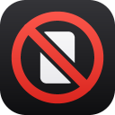
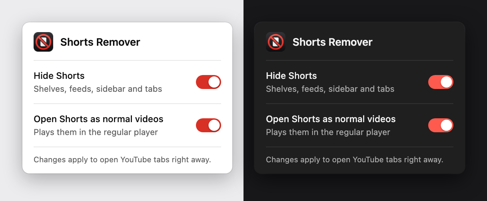

<div align="center">



# Shorts Remover for YouTube

**Hide YouTube Shorts everywhere, and watch Shorts links in the regular player.**

[](https://github.com/itzzharshil/shorts-remover/releases/latest)
[](LICENSE)


[Features](#features) · [Install](#install) · [Usage](#usage) · [Privacy](#privacy) · [FAQ](#faq)



</div>

## Features

- **Shorts are gone from YouTube.** No Shorts shelves on Home, Search,
  Subscriptions or channel pages, and no Shorts mixed into your feeds.
- **Shorts links open as normal videos.** Click, paste or open a
  `youtube.com/shorts/…` link in a new tab and it plays in the regular player,
  with a seek bar, speed controls and comments.
- **Two switches, applied instantly.** Turn either feature on or off from the
  toolbar. Open YouTube tabs update without a reload.
- **Lightweight and private.** No tracking, no network requests, no build
  step. It's plain JavaScript and CSS that you can read in a few minutes.
- **Works in every Chromium browser:** Chrome, Brave, Edge, Opera, Vivaldi,
  Arc and others, on both `www.youtube.com` and `m.youtube.com`.

### What gets removed

| Where | What's hidden |
| --- | --- |
| Sidebar | The **Shorts** entry, in both the full and the collapsed sidebar |
| Home and Subscriptions | Shorts shelves and individual Shorts in the grid |
| Search | Shorts shelves, Shorts results and the **Shorts** filter |
| Channel pages | The **Shorts** tab and Shorts shelves on the channel home |
| Watch page | Shorts in the recommendations sidebar |
| Notifications | Notifications about new Shorts |
| Mobile site | The Shorts tab in the bottom bar, plus Shorts shelves and items |

## Install

The extension isn't on the Chrome Web Store, so you add it in developer mode.
It takes about a minute.

1. **Download** `shorts-remover-v*.zip` from the
   [latest release](https://github.com/itzzharshil/shorts-remover/releases/latest)
   and unzip it. You'll get a folder called `shorts-remover`.
2. **Open your browser's extensions page:**

   | Browser | Address |
   | --- | --- |
   | Chrome | `chrome://extensions` |
   | Brave | `brave://extensions` |
   | Edge | `edge://extensions` |
   | Opera | `opera://extensions` |
   | Vivaldi | `vivaldi://extensions` |

3. **Turn on Developer mode.** It's a switch in the top-right corner (in
   Edge, it's in the left sidebar).
4. **Click Load unpacked** and select the unzipped `shorts-remover` folder.
5. **Pin it (optional):** open the puzzle-piece menu in the toolbar and pin
   Shorts Remover so its switches are one click away.

> [!IMPORTANT]
> Keep the folder somewhere permanent, such as Documents. The browser loads
> the extension from that folder every time it starts, so moving or deleting
> it removes the extension.

<details>
<summary><b>Install from source instead</b></summary>

```bash
git clone https://github.com/itzzharshil/shorts-remover.git
```

Then follow steps 2–4 above and select the cloned `shorts-remover` folder.
To update later, run `git pull` and click the reload icon on the extension's
card.

</details>

## Usage

Click the Shorts Remover icon in the toolbar to open its two switches. Both
are on by default.

- **Hide Shorts:** hides Shorts across YouTube. Turn it off to see them again.
- **Open Shorts as normal videos:** sends `/shorts/` links to the regular
  video player. Turn it off if you want the vertical Shorts player.

Your choices are saved and follow you to other computers if browser sync is
on.

## Updating

Download the newest zip from
[Releases](https://github.com/itzzharshil/shorts-remover/releases), replace
the files in your `shorts-remover` folder with the new ones, then click the
reload icon on the extension's card on the extensions page.

## Privacy

Shorts Remover doesn't collect, store or send any data.

- It only runs on `www.youtube.com` and `m.youtube.com`.
- Its only permission is `storage`, which it uses to remember your two
  switch settings.
- It makes no network requests and contains no analytics or remote code.

## FAQ

<details>
<summary><b>Shorts started showing up again. What happened?</b></summary>

YouTube renames parts of its page from time to time, which can break the
rules that hide Shorts.
[Open an issue](https://github.com/itzzharshil/shorts-remover/issues) with
the page where you saw them and a screenshot, and it'll get fixed. If you'd
like to fix it yourself, right-click the Short, choose **Inspect**, and add a
selector for its outer element to `content.css`.

</details>

<details>
<summary><b>My browser warns about developer-mode extensions. Is that a problem?</b></summary>

No. Chromium browsers show that notice for every extension that wasn't
installed from a web store. You can dismiss it.

</details>

<details>
<summary><b>Does it work in Firefox or Safari?</b></summary>

Not at the moment. It's built and tested for Chromium-based browsers.

</details>

<details>
<summary><b>Can I still watch a Short when I want to?</b></summary>

Yes. Turn off **Open Shorts as normal videos** to use the Shorts player, and
turn off **Hide Shorts** to bring Shorts back into your feeds.

</details>

## How it works

| File | Role |
| --- | --- |
| [`manifest.json`](manifest.json) | Manifest V3 definition. The content script runs on YouTube only. |
| [`content.css`](content.css) | The selectors that hide Shorts. Everything is switched on and off by one class on the page. |
| [`content.js`](content.js) | Applies your settings, redirects `/shorts/` URLs and clicks, and hides controls that are only identifiable by their "Shorts" label. |
| [`popup.html`](popup.html), [`popup.css`](popup.css), [`popup.js`](popup.js) | The toolbar popup with the two switches. |
| [`icons/`](icons) | Extension icons, drawn by [`tools/make_icons.py`](tools/make_icons.py). |

Elements are hidden rather than deleted, because YouTube reuses parts of its
page as you browse and breaks if they're removed. To redraw the icons after
changing the script, run `python3 tools/make_icons.py`; it only needs the
Python standard library.

## License

[MIT](LICENSE) © Harshil Joshi
